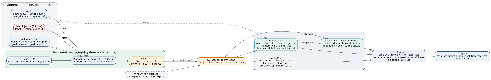

# TraceLens — critical-trace extraction for agentic AI systems

Course project **G2-01** (AI4015 Agentic AI, Fall 2026): *Understanding and Extracting Critical Traces in Agentic AI Systems.*
Group head: 23I-0594.  Supervisor: Meemon Khan.  **Base paper:** Zhang et al., *Which Agent Causes Task Failures and When?* (ICML 2025, Who&When) — see `research/PAPER_NOTES.md` for what was verified and what you must still verify.



## What is in the repository

| Path | What it is | Phase |
|---|---|---|
| `tracelens/schema.py` | Trace schema v1 (`content` / `inputs` / `parents`), validation, JSONL I/O, observability views | 1 |
| `tracelens/world.py` | Deterministic offline document world, BM25 search, replayable tools, task generator | 1 |
| `tracelens/agent.py` | Instrumented agent (plan → search → read → memory → calc → answer) with 8 injectable faults, each with a ground-truth event id | 1 |
| `tracelens/llm.py` | Model providers: scripted offline policy, **Ollama**, any OpenAI-compatible endpoint (stdlib only) | 1 |
| `tracelens/extract/baselines.py` | Heuristic baselines (random, first, last, last-tool-output, first-error-signal) | 1 |
| `tracelens/extract/judge.py` | LLM-judge baselines in the style of the base paper (all-at-once, step-by-step, binary search) | 1 |
| `tracelens/extract/evidence.py` | **Gap 1** — evidence-linked verifier (7 deterministic rules) | 2 |
| `tracelens/extract/summarize.py` | **Gap 3** — budgeted critical-trace summaries with event-linked quotes + faithfulness check | 2 |
| `tracelens/schema.py` views | **Gap 2** — which logged fields matter (full / no_links / no_inputs / output_only) | 2 |
| `tracelens/eval/` | benchmark builder, metrics (+95% Wilson CIs), phase runners, Who&When adapter, HTML viewer, gap table | 1–2 |
| `tests/` | 45 tests | 1–2 |
| `results/` | outputs of one full run (regenerate any time) | 1–2 |
| `research/PAPER_NOTES.md` | verified paper facts, venue/rank proof status, candidate gaps | 1 |

## Quick start (no internet, no GPU, no API key)

```bash
python -m tracelens all --out results      # ~15 s: benchmark + phase 1 + phase 2 + viewer
python -m pytest                           # 45 tests
```
Then open `results/viewer.html`. Full OS-specific instructions: **RUN_GUIDE.md**.

## The honest limits (read before quoting any number)

1. **The offline benchmark is synthetic and was built together with the verifier.** It contains 9 fault types (8 detectable + `source_error`, which replay cannot reveal). Near-perfect scores on the detectable ones show the machinery works — nothing more. `source_error` scores 0 on purpose: it demonstrates what the method cannot do.
2. **The default agent is a rule-based stand-in for an LLM.** Use `--policy ollama:<model>` to generate traces with a real model; natural errors then appear and the clean-run success rate becomes a real measurement.
3. **The Who&When adapter has not been run on the real files** (no internet in the build sandbox). Use `whowhen --inspect` first; it auto-detects 0/1-based step indices and prints the structure it found.
4. **The LLM-judge baselines are re-implementations from the method descriptions**, not the authors' code or prompts.
5. **The Gap 1 verifier is environment-specific** (it knows plan / memory / calculator semantics). Whether a *generic* version transfers to Who&When-style logs is exactly the open research question; Phase 2 must answer it with real data.
6. Token counts are a 4-characters-per-token estimate.

## Typical commands

```bash
python -m tracelens build-bench --out results --tasks-per-type 12
python -m tracelens phase1 --out results                       # baselines
python -m tracelens phase2 --out results                       # gaps, ablations, gap table
python -m tracelens viewer --out results                       # results/viewer.html

# with a real local model (install Ollama, `ollama pull qwen2.5:7b`)
python -m tracelens run-agent --policy ollama:qwen2.5:7b --n 8 --fault calc_error
python -m tracelens all --out results_llm --policy ollama:qwen2.5:7b --judge ollama:qwen2.5:7b --tasks-per-type 4

# base-paper data
python -m tracelens whowhen --path data/who_and_when --inspect
python -m tracelens whowhen --path data/who_and_when --judge ollama:qwen2.5:7b --limit 40
python -m tracelens phase2 --out results                       # re-run to refresh gap_resolution_table.md with Who&When numbers
```

## Contracts

* **Trace** (`schema.py`): `Event(id, kind, actor, content, inputs, parents, status, ts)`; kinds: goal, plan, tool_call, tool_result, memory_write, memory_read, error, retry, final_answer, message. Ground-truth `labels` never reach an extractor (`Trace.view()` strips them).
* **Attribution** (`extract/base.py`): `Attribution(method, ranking[(event_id, score, reason)], cost)`.
* **Summary** (`extract/summarize.py`): `Summary(items[Item(event_id, role, quote, note)])`; every quote must be grounded in its event.
* **Completer** (`llm.py`): `str -> str` with token/latency accounting.

## Git history

Commit as you really work, one logical change per commit, from each member's own account. The repository layout above maps to the Phase 1 rubric items C1/C2 (see `docs/PHASE1_CHECKLIST.md`).
